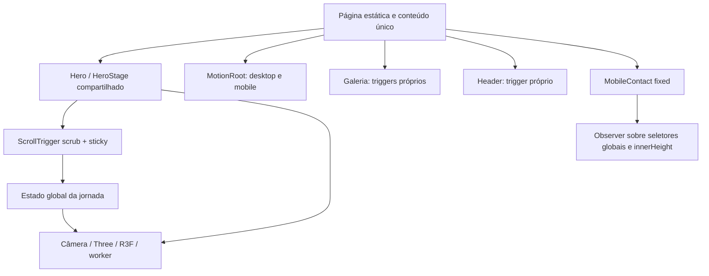
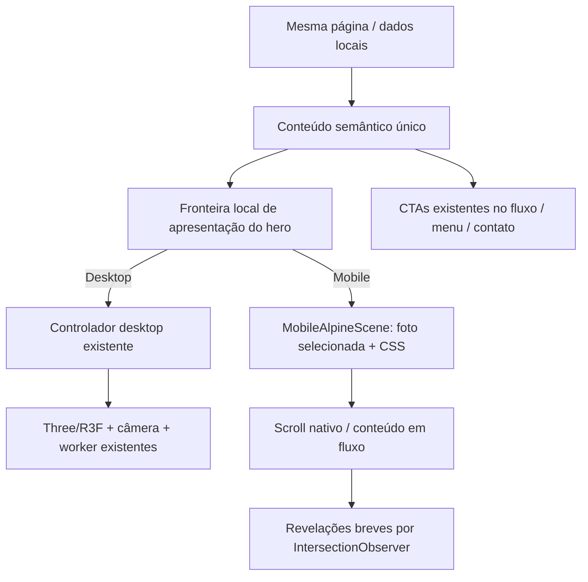

# Plano técnico: apresentação e scroll exclusivamente mobile

Status: aprovado em 03/11/2026, com substituição do SVG proposto por uma foto das paisagens selecionadas no projeto.
Data: 03/11/2026. Base analisada: e4a74ec. Alvo relatado: iPhone 14 Pro, Safari, retrato.

## Requisitos e limites

- Remover do mobile a animação atual das montanhas e substituí-la por uma nova apresentação leve e clean.
- Corrigir a fluidez e retirar o contato flutuante que aparece no meio da tela.
- Preservar o desktop, a arquitetura Next/React existente, o conteúdo factual, identidade, cores, mensagens e contatos.
- Manter animação mobile, mas sem renderer 3D e sem coreografia que controle continuamente o scroll.
- Seguir em pequenos commits, com testes e rollback independentes; sem push/deploy nesta fase.
- A regra antiga de preservar 3D em todos os dispositivos foi substituída pelo novo pedido somente no mobile. Atualizar PRODUCT.md após a decisão ser aceita, sem reescrever o contexto do produto.

## 1. Arquitetura e domínios existentes

Aplicação institucional Next.js 16.4.3, React, TypeScript e Tailwind. Build anterior gerou páginas estáticas; não há backend de reservas, autenticação, pagamentos ou banco a migrar. Server Components apresentam dados locais; ilhas cliente cuidam de navegação, galeria e animação.

| Domínio/responsabilidade | Módulos | Dependências e limites |
|---|---|---|
| Identidade e apresentação profissional | site.ts, Hero, About, layout | Conteúdo local, fontes, next/image; preservar fatos e marca |
| Oferta de serviços | site.ts, Services | Três ofertas e mensagens WhatsApp; não é um backend de reservas |
| Inspiração por destinos | data/paisagens*, GaleriaPaisagens, Lightbox | Fotos/licenças locais, filtros React, next/image, GSAP |
| Conversão e contato | Button, Contact, MenuOverlay, MobileContact | wa.me e Instagram; número depende de env pública |
| Navegação e acessibilidade | Header, MenuOverlay, scroll.ts | Dialog nativo, foco, âncoras, Lenis opcional |
| Apresentação/movimento transversal | HeroStage, MotionRoot, lib/world/* | GSAP/ScrollTrigger/SplitText, Three/R3F, worker, CSS global |

O problema está na camada de apresentação, não nos domínios de negócio. A escala do site não justifica novos serviços, banco ou infraestrutura.

### Fluxo atual relevante

## 2. Evidências e acoplamentos

Confirmado em fonte, sem inferir FPS do aparelho:

1. HeroStage usa uma única timeline de atos em ambos os modos e publica progresso para a câmera em cada atualização. O low tier não remove WebGL, worker nem shaders.
2. CSS mobile define 480svh de corredor e viewport sticky. Leitura, foco e rolagem ficam vinculados a atos/transições e às medidas da viewport.
3. Lenis já é restrito a desktop com hover/pointer fine. A reclamação de scroll no Safari não pode ser resolvida simplesmente repetindo essa alteração.
4. MotionRoot, GaleriaPaisagens e Header possuem donos separados de ScrollTrigger. MotionRoot observa load no document e atualiza medidas globalmente; trabalho adicional pode coincidir com navegação/carregamento. É hipótese de contribuição, exige trace.
5. HeroStage depende de estado global, classes em html, seletores do header/DOM e eventos globais matchMedia, incluindo tipos ausentes na declaração GSAP. A nova apresentação mobile não deve herdar esse controlador.
6. MobileContact observa elementos de toda a página e recalcula sua região por innerHeight; o posicionamento é fixed. Essa política depende de detalhes de layout de outros módulos e foi insuficiente no Safari relatado. Não há evidência suficiente para atribuir a posição no meio da tela a uma única causa de viewport/containing block.
7. CSS global combina regras de base, modo JS, reduced-motion, mobile e cenas imersivas. Um simples display:none do canvas manteria acoplamento e não garantiria ausência de download/execução 3D.

Os números anteriores (Performance mobile 96, TBT ~207ms) medem carregamento em laboratório. Não provam fluidez durante gesto, inércia, GPU ou barra retrátil do Safari no iPhone.

## 3. Desenho proposto

### Experiência mobile concreta

- Foto do Matterhorn, já selecionada na galeria, com variantes AVIF/WebP locais e créditos existentes. Não introduzir conteúdo novo.
- Entrada curta de aproximadamente 450–700ms em transform/opacity, disparada uma vez. Depois a composição repousa; não fica perseguindo o scroll nem repetindo movimentos.
- Título e CTA utilizáveis desde o início. Texto, fatos e retrato existentes seguem em fluxo normal; não ficam escondidos atrás de progressos de câmera.
- Sem sticky de narrativa, corredor de 480svh, blur de fundo, parallax contínuo, partículas ou loop requestAnimationFrame no novo módulo.
- Reduced-motion/saveData: fotografia estática. Falha de JS: conteúdo visível. Não introduzir uma imagem/vídeo pesado como substituição.
- Revelações editoriais e da galeria mobile: observer com entrada leve de opacity/transform; uma vez; sem esconder conteúdo no HTML padrão.
- Contato flutuante retirado, preservando as ações reais do hero, serviços, menu e final da página. Não adicionar outra barra fixa.

### Fronteira e seleção de modo

Proposta explícita: mobile em <=767px, ou touch primário sem hover até 1023px, cobrindo telefone em paisagem. Desktop com mouse a partir de 768px continua no caminho atual; >=1024px conserva desktop. Testar essa política em dispositivos híbridos e em rotação. A regra deve ser idêntica para seleção JS e layout CSS.

A seleção precisa ocorrer antes da montagem do runtime desktop. A implementação mantém a entrada pequena do controlador disponível sem outro request; a fronteira dinâmica continua no renderer pesado Three/R3F. Esse trade-off evita atrasar a entrada desktop e é verificado pela ausência de recursos 3D no mobile. CSS ocultando canvas não basta. Verificar a rede para garantir que mobile não solicita Three/R3F nem terrain.worker. Não duplicar h1, IDs, texto ou CTAs. A extração do controlador desktop é mecânica e local ao hero; não muda rotas, stack nem contratos de negócio.

GSAP ainda pode estar no JS mobile por header/menu. Não prometer sua eliminação completa: a meta é tirar o renderer 3D e o trabalho de scroll decorativo. Se traces mostrarem custo significativo no header, simplificar apenas seu ramo mobile em commit separado, sem alterar o desktop.

## 4. Alternativas e trade-offs

| Opção | Desempenho/manutenção | Desktop | Decisão |
|---|---|---|---|
| Mais ajustes no mesmo 3D | Continua custo de GPU e estados | Pequeno diff, acoplamento permanece | Rejeitar |
| Novo Canvas 2D | Outro motor, loop/resize próprios | Isolável, mas manutenção maior | Rejeitar |
| Vídeo/GIF | Rede, decoder e autoplay | Isolável | Rejeitar |
| Foto com movimento breve | Simples, variantes locais responsivas | Isolável | Escolhida pelo responsável |
| Foto selecionada + CSS + observer | Poucos elementos, sem loop, fallback nativo | Controlador atual preservado | Recomendar |
| Reescrita integral | Risco e esforço desnecessários | Alto risco de regressão | Rejeitar |

Trade-offs aceitos na proposta: menos realismo/imersão no mobile; contato deixa de ser persistente; dois pequenos controladores de apresentação. Em troca, conteúdo previsível, menor execução durante scroll e testes independentes. Dependências 3D não são removidas do package.json, pois continuam necessárias no desktop.

## 5. Segurança, escalabilidade e operação

- Manter dados estáticos, fronteiras cliente/servidor e cabeçalhos existentes. A mudança não requer autenticação, APIs, armazenamento, scripts externos ou dependências adicionais.
- Não coletar dados novos nem adicionar telemetria externa. Env pública de WhatsApp continua configuração pública; não criar número ou inserir segredos.
- Imagem local, sem scripts/URLs externos/conteúdo injetado de terceiros. Manter rel=noopener noreferrer em links externos e tratamento acessível de diálogos.
- Isto é uma revisão arquitetural da área alterada, não um pentest nem declaração de ausência de vulnerabilidades.
- Manter capacidade de distribuição estática/CDN da aplicação. Menos ativos em mobile deve reduzir custo de transferência; quantificar em requests reais. Não inventar metas de usuários concorrentes ou adicionar cache/filas sem necessidade.
- Isolar regras mobile em módulo/estilos próprios; evitar novos seletores globais e estado compartilhado de progresso para a cena nova.

## 6. Implementação incremental e commits propostos

1. Diagnóstico reproduzível e baseline atual: rede, trace de scroll, visual e entradas por hash, alvo Safari informado. Documentar planos/ADRs como propostos.
2. Retirar MobileContact e sua compensação mobile. Conferir CTAs originais, foco e ausência de sobreposição.
3. Extrair mecanicamente o controlador desktop e estabelecer a seleção mobile/desktop. Comparar desktop antes de introduzir a nova cena. Nenhuma mudança de câmera/timing desktop.
4. Implementar MobileAlpineScene e layout de leitura mobile, com fallback estático. Garantir zero montagem de WebGL/worker nesse caminho.
5. Trocar reveals mobile em MotionRoot/galeria para observer/CSS e limitar refreshs necessários. Medir header/menu antes de ampliar mudanças.
6. Validar matriz, corrigir achados, repetir métricas e documentar comparações. ADRs aceitos após revisão do responsável; um commit claro por etapa.

## 7. Critérios de aceitação e testes

| Área | Evidência esperada |
|---|---|
| Alvo principal | Safari/iPhone 14 Pro retrato: gesto lento/rápido e inércia, barra expandida/recolhida, safe areas, alternância de aba |
| Rede mobile | Sem download de Three/R3F/terrain.worker gerado pelo hero, sem WebGL em toda a navegação |
| Runtime mobile | Sem timeline scrub/pin do hero, sem loop permanente da nova cena, sem listeners touch bloqueando gesto |
| Contato | Nenhum contato fixed/sticky; mensagens/links iguais; ações acessíveis no fluxo |
| Layout | 360/390/393/414/768/1024px; retrato/paisagem; zoom; sem overflow horizontal/cortes/IDs duplicados |
| Navegação | Menu: abrir/fechar/Escape, foco e trava/liberação; âncoras na carga direta e pelo menu; voltar/avançar; lightbox/filtros |
| Preferências/falhas | Reduced-motion, saveData, JS indisponível, falha ao carregar controlador; conteúdo continua visível |
| Ciclo de vida | Girar/alternar modo repetidamente não duplica triggers/listeners nem inicia renderer desktop em telefone paisagem |
| Desktop protegido | Comparação visual e dos marcos da câmera nas mesmas posições/progressos, header/menu/galeria intactos; medir desempenho antes/depois |
| Qualidade | npm run build, npm run lint, npm run typecheck |

Performance: medir frames durante scroll e long tasks atribuíveis à aplicação; alvo próximo de 60fps, sem prometer esse resultado antes da medição física. LCP <2.5s, CLS <0.1, Lighthouse Performance >=90 e acessibilidade >=95 continuam referências de carregamento. INP <200ms exige interações e/ou dados de campo, não deduzir de TBT.

Quando não houver acesso ao Safari físico/remoto, registrar claramente o limite: emulação Chrome não certifica a correção no aparelho relatado. Não usar Lighthouse isolado como aceite de fluidez.

Testes automatizados focados nos riscos de regressão: seleção/montagem por modo, ausência de recursos 3D no mobile, ciclo de troca de modo, CTAs não sobrepostos e invariantes desktop. Não criar snapshots que apenas espelhem a implementação.

## 8. Rollback

- Commits independentes; usar revert dos commits específicos, sem reset de alterações do usuário.
- Falha na nova animação mobile: entregar fotografia estática com fluxo normal. Não carregar o 3D mobile como fallback.
- Regressão desktop na extração: reverter a etapa de fronteira/extração e interromper avanço até comparação passar.
- Manter a retirada do botão flutuante e o scroll nativo mesmo se o refinamento visual precisar recuar.
- Sem feature flag, serviço de configuração ou deploy paralelo: escopo local não justifica essa infraestrutura. Publicação só após validação e autorização de envio pertinente.

## Decisões para revisão

- ADR-0001: cena mobile fotográfica independente; desktop existente preservado.
- ADR-0002: scroll nativo + revelações leves e contato em fluxo normal.

Aprovação não é evidência de desempenho alcançado; resultados devem ser registrados após implementação e testes.
